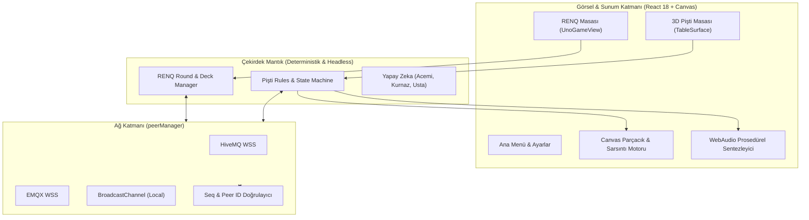

# 🎴 Project P: Pişti & RENQ Overdrive

[](./package.json)
[](https://react.dev/)
[](https://www.typescriptlang.org/)
[](https://vitejs.dev/)
[](https://tailwindcss.com/)
[](#-güçlü-çevrimiçi-multiplayer-mimarisi)
[](#-lisans)

> **Geleneksel Türk Kart Oyunu Pişti ve Heyecan Dolu Kart Düellosu RENQ'in; Arcade Görsel Efektler, Prosedürel Web Audio, 60–240Hz Adaptif WAAPI Fiziği ve P2P/MQTT Ağ Mimarisiyle Yeniden Doğuşu.**

---

## 🌟 Proje Özeti & Vizyon

**Project P**, klasik kart oyunlarını sıradan 2D düzlemden çıkarıp, her hamlenin tatmin ettiği bir **"Juicy Arcade"** deneyimine dönüştüren modern bir web oyunudur. İki amiral gemisi oyun modunu tek çatı altında buluşturur:

1. **Pişti: Overdrive**: Yüzyıllardır kahvehanelerde ve evlerde oynanan 52'lik geleneksel Türk iskambil oyunu; dramatik kart sarsıntıları, 5 farklı profesyonel deste karma sekansı, Vale girdapları, altın şok dalgaları ve canlı masa sayım töreniyle taçlandırılmıştır.
2. **RENQ**: Stratejik renk, sayı ve aksiyon kartlarının (+2, +4, Pas, Yön Değiştirme, Renk Seçici) yarıştığı, hızlı tempolu ve dinamik bir parti kart oyunu.

---

## 🎮 Oyun Modları & Mekanikler

### 1. Pişti: Overdrive
- **Klasik & 5'e Basmalı Varyantı**: Standart puanlamanın yanı sıra tek 5'e 5 basıldığında maçı anında kazandıran opsiyonel kahvehane kuralı.
- **2 ve 4 Kişilik (Eşli Takım)**: Teke tek düello veya karşılıklı ortaklı eşli mücadele.
- **Canlı Masa Sayım Töreni**: 52 kart bittiğinde kartlar masaya dökülür; prosedürel ses efektleriyle tek tek sayılarak puan kartları (♦10, ♣2, As, Vale) ve çoğunluk bonusu canlı hesaplanır.
- **Çapraz Pişti Yığını**: Yapılan Piştiler sıradan desteye karışmaz; masanın kenarında 90 derece dik açıyla istiflenir.

### 2. RENQ
- **Dinamik Kart Çekme ve Eşleme**: Renk, sembol veya aksiyon eşlemesi.
- **Ceza ve Pas Senkronizasyonu**: Masadaki biriken +2 / +4 cezaları, pas geçme ve renk seçimi anlık olarak tüm rakiplere senkronize edilir.
- **Son Kart Uyarısı**: Elinde tek kart kalan oyuncunun "RENQ!" butonuna basma zorunluluğu; unutursa +2 ceza kartı çekme mekaniği.

---

## ⚡ "Overdrive" Görsellik ve Fizik Motoru

Sıradan kart oyunlarının aksine **Project P**, her hamlede dokunsal ve görsel geri bildirim sunar:

- **60–240Hz Adaptif WAAPI Fizik Motoru**: Monitör yenileme hızına duyarlı Web Animations API tabanlı yörüngeli 3D kart uçuşları.
- **5 Farklı Gerçekçi Deste Karma Stili**:
  1. *Harman & Şelale Köprüsü (Riffle & Bridge Cascade)*
  2. *Hindu / Üstten Paket Çekme (Packet Slide)*
  3. *Kahvehane 3'lü Masa Kesimi (Triple Cut)*
  4. *Masa Üstü Çorba Karıştırma (Casino Table Wash)*
  5. *Kavisli Yelpaze & Dalga Şelalesi (Farot S-Curve)*
- **Prosedürel Web Audio**: Dışarıdan MP3 indirmeden, HTML5 Web Audio API ile sıfır gecikmeli üretilen kart fışırtıları, ahşap vuruşları, bas patlamaları ve zafer arpejleri.
- **7 Dinamik Masa Teması**: Kıraathane Lüksü, Zümrüt Yeşili, Gece Mavisi, Cyberpunk Neon Grid, Galaktik Kozmos, Sonbahar Meşesi ve Minimalist Slate.
- **Parçacık Efektleri**: Sakura yaprakları, neon kıvılcımlar, alev dalgaları ve zafer konfetisi.

---

## 🌐 Güçlü Çevrimiçi Multiplayer Mimarisi

- **Çift Broker Yedekliliği (Dual MQTT Fallback)**: HiveMQ ve EMQX genel WebSocket broker'ları arasında otomatik geçiş ve yedekleme.
- **Yerel Sekmeler Arası Ağ**: Aynı tarayıcıda veya yerel ağda `BroadcastChannel` ile anında sıfır gecikmeli test imkanı.
- **Güvenli Oda Kodları**: `PST-xxxxxx` ve `RNQ-xxxxxx` formatında 2 milyardan fazla kombinasyona sahip kriptografik oda anahtarları.
- **Paket Doğrulama & Anti-Replay**:
  - Koltuk ve Gönderici Kimlik Doğrulaması (`senderSlot.peerId === msg.senderPeerId`).
  - Sıra kontrolü ve yetkisiz hamle engelleme.
  - Monoton dizi numarası (`seq`) takibiyle tekrarlanan/sahte paketlerin filtrelenmesi.
- **Sosyal Etkileşim**: Canlı emoji fırlatma (☕ Çay, 🔥 Alev, 😂 Kahkaha vb.) ve 80 karakter sınırlı sanitize edilmiş masa içi sohbet.

---

## 🏗️ Mimari Şema



---

## 🚀 Hızlı Başlangıç

### Gereksinimler
- Node.js v18 veya üzeri (v20+ önerilir)
- npm, pnpm veya yarn

### Kurulum ve Çalıştırma

```bash
# 1. Bağımlılıkları yükleyin
npm install

# 2. Geliştirme sunucusunu başlatın
npm run dev

# 3. Tarayıcınızda açın:
# http://localhost:5173
```

### Üretim (Build) Alma

```bash
npm run build
npm run preview
```

---

## 🗺️ Gelecek Yol Haritası

Gelecek sürümlerde hedeflenen yetkili sunucu mimarisi, maç replay motoru, günlük tohum bulmacaları, mobil haptik dokunmatik kontroller ve daha fazlası için lütfen [ROADMAP.md](./ROADMAP.md) belgesini inceleyin.

---

## 📄 Lisans

Bu proje MIT lisansı kapsamında korunmaktadır. Detaylar için `LICENSE` dosyasına başvurabilirsiniz.
