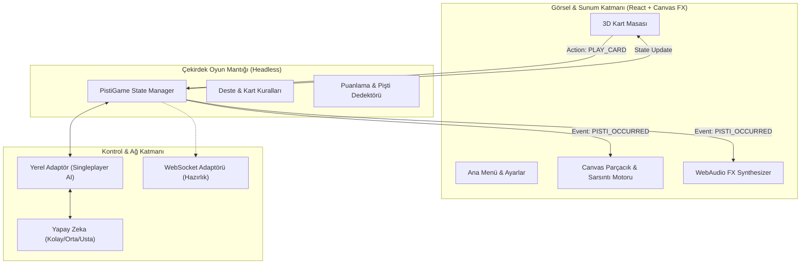

# 🎴 Project Pişti: Overdrive (Pişti Arcade)

> **Klasik Türk Kart Oyunu Pişti'nin "Arcade & Juicy" Görsel Efektler ve Modern Mimariyle Yeniden Doğuşu.**

---

## 🌟 Proje Özeti & Vizyon

**Project Pişti: Overdrive**, yüzyıllardır kahvehanelerde ve evlerde oynanan geleneksel 52'lik Türk iskambil oyunu Pişti'yi alıp; **dramatik animasyonlar, ekran sarsıntıları, parçacık şok dalgaları, sinematik "Pişti Slam" sekansları ve procedürel ses efektleriyle** modern bir video oyunu hissiyle harmanlayan üst düzey bir web/masaüstü projesidir.

Mekanik kurallara %100 sadık kalınırken, his ve atmosfer olarak gerçekçiliğin ötesine geçilmiş; her kart atışında hissedilen ağırlık, Vale darbeleri ve Pişti patlamaları saf bir tatmin ("game juice") sunacak şekilde kurgulanmıştır.

---

## 🕹️ Oyun Mekanikleri & Kurallar

Pişti standart 52 kartlık tek deste ile oynanır.

### Dağıtım ve Başlangıç
1. Dağıtıcı her oyuncuya 4'er kart verir.
2. Masanın ortasına 4 kart açılır: İlk 3 kart kapalı (gizli), en üstteki 4. kart açık konulur.
3. El bittiğinde destede kart kaldığı sürece oyunculara dörder kart dağıtılmaya devam eder (toplam 6 el dağıtımı = 48 kart + yerdeki 4 kart = 52 kart).

### Tur Akışı
- Sırası gelen oyuncu elindeki bir kartı ortaya atar.
- Yerdeki en üstteki kart ile **aynı değerde** bir kart atan oyuncu yerdeki tüm kartları toplar.
- **Vale (J)** her zaman yerdeki tüm kartları toplar ("Süpürme").
- Masada **tek bir kart** varken, rakip aynı değerdeki kartı atarsa **PİŞTİ** yapılmış olur!
- Masada **tek bir Vale** varken, rakip Vale atarsa bu **ÇİFT PİŞTİ** (Süper Pişti - 20 Puan) sayılır!

### Puanlama & Özel Kurallar
| Kart / Durum | Puan | Açıklama |
| :--- | :---: | :--- |
| **Pişti (Normal)** | **10** | Boş masadaki tek karta aynı değerde kart basıldığında |
| **Vale Piştisi (Çift Pişti)** | **20** | Masada tek Vale varken Vale basıldığında |
| **5'e Basmalı (Özel Varyant)** | **KAZANMA** | Masada tek 5 varken 5 ile Pişti yapan skora bakılmaksızın maçı anında kazanır! |
| **Karo 10 (Onlu)** | **3** | "Büyük Pişti Parası" |
| **Sinek 2 (İkili)** | **2** | "Küçük Pişti Parası" |
| **Aslar (A)** | **1** | Toplam 4 adet As (her biri 1 puan) |
| **Valeler (J)** | **1** | Toplam 4 adet Vale (her biri 1 puan) |
| **Kart Çoğunluğu** | **3** | 26'dan fazla kart toplayan oyuncuya ek 3 puan verilir |
| **Oyun Bitişi** | **51 / 101 / 151 / 201** | Belirlenen hedef skora ilk ulaşan oyunu kazanır |

---

## ⚡ "Overdrive" Görsellik & Animasyon Şöleni (Game Feel / Juice)

Sıradan 2D kart oyunlarının aksine bu projede kartlar sadece kaymaz; masa canlanır!

```
      [ Oyun Başı ] ──> Deste Bölünmesi & Gerçekçi Kart Karma (Riffle Shuffle) Sesi & Animasyonu
             │
      [ Dağıtma ] ──> Desteden Masaya ve Oyuncuların Eline 4'er 4'er Süzülen Uçan Kartlar
             │
      [ Kart Atışı ] ──> Oyuncunun Elinden Masanın Merkezine Yörüngeli 3D Uçuş & Tok Ahşap Vuruşu
             │
      [ Vale Hamlesi ] ──> Altın Girdap (Vortex) Efekti + Masadaki Kartların Havalanması
             │
      [ P İ Ş T İ ! ] ──> 💥 SLOW-MOTION MİKRO DURAKLAMA (Hit-stop)
                          💥 EKRAN SARSINTISI (Screen Shake)
                          💥 ŞOK DALGASI & PARÇACIK PATLAMASI (Shockwave FX)
                          💥 3D KABARAN DİNAMİK LOGO: "P İ Ş T İ ! +10" / "5'E BASTI! +KAZANDI"
                          💥 WEBAUDIO PROSEDÜREL BAS PATLAMASI & FANFAR
```

### Öne Çıkan Görsel ve Hissiyat Öğeleri:
1. **5 Farklı Deste Karma Animasyonu (Rastgele Seçim)**:
   - *1. Klasik Harman & Şelale Köprüsü (Riffle & Bridge Cascade)*: Deste ikiye ayrılır, birbirine geçer ve yay gibi bükülerek şelale gibi akar.
   - *2. Hindu / Üstten Paket Çekme (Packet Slide)*: Sağ eldeki desteden 4'erli paketler çekilerek sol eldeki desteye bindirilir.
   - *3. Kahvehane 3'lü Masa Kesimi (Triple Cut)*: Deste masaya 3 parça halinde vurulup çapraz şekilde birleştirilir.
   - *4. Masa Üstü Çorba Karıştırma (Casino Table Wash Scramble)*: 24 kart masanın dört bir yanına saçılıp girdap gibi dönerek düzgünce toplanır.
   - *5. Kavisli Yelpaze & Dalga Şelalesi (Farot S-Curve Wave)*: İki yarım deste yelpaze gibi kavis açıp dalga hareketiyle kapanır.
2. **Pişti Kartlarının 90 Derece Çapraz (Tersli Düzlü) Ayrı Yığını**:
   - Pişti veya Çift Pişti yapıldığında kartlar normal toplanan kartların içine karışmaz! Yan taraftaki özel "Pişti Destesi"ne biri 0 derece, diğeri tam **90 derece dik açı** ile üst üste çapraz yerleşir.
3. **El Bitimi Canlı "Tık Tık Tık" Sayım Töreni**:
   - 52 kart bittiğinde kartlar doğrudan pop-up tablosuyla kapanmaz; masaya dökülüp gerçekçi "tık tık tık" sesleriyle canlı olarak sayılır. Puan kartları (`♦10`, `♣2`, `As`, `Vale`) ayrılır, 27 kartı geçen tarafın çoğunluk bonusu havai fişekle kutlanır.
4. **Faz 1 Canlı Multiplayer (P2P WebRTC)**:
   - 6 haneli oda kodu ile bağlanma, 15 saniyelik hamle geri sayım barı ve masaya fırlatılabilen interaktif emojiler (Çay ☕, Alev 🔥, Kahkaha 😂, vb.).
3. **Masa Temaları**:
   - 🌲 *Geleneksel Kıraathane Lüksü*: Zümrüt yeşili çuha, ceviz ağacı kaplama, nostaljik çay bardağı tıkırtısı atmosferi.
   - ⚡ *Cyberpunk Neon Grid*: Tron tarzı ışıldayan hatlar, hologram kartlar, mor/cyan lazer patlamaları.
   - 🌌 *Galaktik Kozmos*: Yıldız tozu, yerçekimsiz süzülen kartlar ve nebula şok dalgaları.
4. **Prosedürel Web Audio Ses Tasarımı**:
   - Dışarıdan MP3 indirme bağımlılığı olmadan, HTML5 Web Audio API ile sıfır gecikmeli üretilen kart fışırtıları, ahşap vuruşları, bas patlamaları ve zafer arpejleri.

---

## 🏗️ Mimari & Kod Yapısı

Sistem, gelecekteki **Çok Oyunculu (Multiplayer)** yapısını sıfır zahmetle entegre edebilmek için **Event-Driven / Headless State Machine** prensibiyle inşa edilmiştir.



### Katman Açıklamaları:
- **`src/core/engine/`**: Oyunun kurallarının işletildiği, arayüzden ve DOM'dan tamamen bağımsız TypeScript motoru. Tek bir `dispatch({ type: 'PLAY_CARD', cardId, playerId })` fonksiyonu ile çalışır.
- **`src/core/ai/`**: Kolay (rastgele/acemi), Normal (hafıza ve el takibi) ve Usta (kart sayan, rakibin pişti ihtimalini minimize eden ve karo 10 / sinek 2 saklayan) botlar.
- **`src/core/audio/`**: Synthesizer tabanlı dinamik ses motoru.
- **`src/core/particles/`**: Özel 60 FPS HTML5 Canvas parçacık motoru (konfeti, alev, elektrik, duman).
- **`src/features/multiplayer/`**: İleride eklenecek Socket.io / WebRTC multiplayer için arayüz (Interface) tanımları.

---

## 🚀 Hızlı Başlangıç

### Gereksinimler
- Node.js (v18 veya üzeri önerilir - test edilen v24+)
- npm veya yarn

### Kurulum ve Çalıştırma
```bash
# Proje bağımlılıklarını kurun
npm install

# Geliştirme sunucusunu başlatın
npm run dev

# Tarayıcınızda açın: http://localhost:5173
```

---

## 👥 Gelecek Planı: Multiplayer (Çok Oyunculu)

Projenin mevcut fazında Singleplayer (Gelişmiş Yapay Zeka ile) tam teşekküllü olarak hayata geçirilecek; ardından **Faz 5** kapsamında:
1. Oda kurma / Odaya katılma (Room Code),
2. Eşzamanlı kart atma ve ping kompanzasyonu,
3. Canlı emoji / hızlı sohbet fırlatma,
4. Çevrimiçi liderlik tablosu
kolaylıkla eklenecektir.

Detaylı aşamalar için lütfen [ROADMAP.md](file:///c:/Users/Ado/Desktop/project%20P/ROADMAP.md) dosyasını inceleyin.
