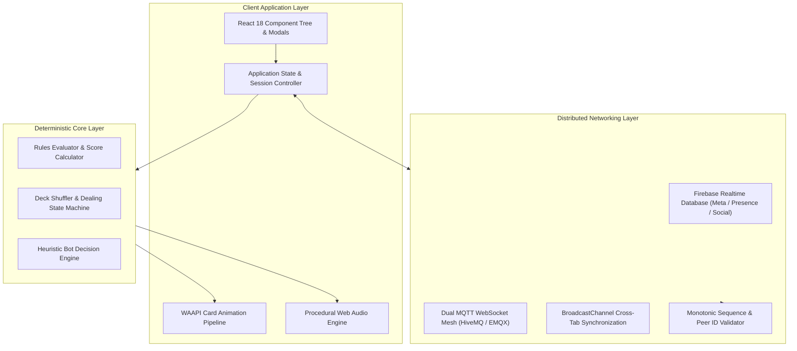

# Project P (Peeshtee: Overdrive)

A high-performance, deterministic card game platform and real-time multiplayer engine built with TypeScript, React 18, Web Animations API (WAAPI), procedural Web Audio API, and Firebase Realtime Database.

[](https://www.typescriptlang.org/)
[](https://react.dev/)
[](https://vitejs.dev/)
[](https://firebase.google.com/)
[](./LICENSE)

---

## Architecture Overview

Project P is structured as a modular client application separating core simulation logic, rendering pipelines, audio synthesis, and distributed networking.



---

## Technical Specifications

### 1. Deterministic Core Engine
- **Headless State Evaluation**: Core rule checks and round computations execute independently of the presentation tree.
- **Rule Matrix**: Computes matching conditions, bonus card values, sweeps, capture points, and team scores with deterministic outcomes.
- **Bot Engine**: Heuristic decision trees operating across three difficulty tiers (Easy, Medium, Hard) taking into account pile memory, card distributions, and risk assessments.

### 2. Animation & Rendering Pipeline
- **WAAPI (Web Animations API)**: 60Hz–240Hz adaptive animation execution bypassing main-thread UI layout thrashing.
- **Physical Deck Choreography**: 3D transform trajectories for multi-step shuffle sequences, pack sliding, cut-deck displacement, and collection gathering.
- **Hardware-Accelerated FX**: 2D Canvas particles and GPU composite layers for dynamic impact and particle simulations.

### 3. Procedural Audio Synthesis
- **Zero Static Audio Assets**: Procedural Web Audio API sound generator synthesizing card slides, strikes, sweeps, and fanfares dynamically.
- **Polyphonic Ambient Synthesis**: Real-time ambient backdrop synthesis with independent volume control and master mute states.

### 4. Distributed Networking & Cloud Synchronization
- **Cloud State & Persistence**: Google Firebase Realtime Database for instantaneous room discovery, persistent presence indicators, real-time friend graph synchronization, and direct match invites.
- **P2P/WebSocket Transport**: Dual MQTT WebSocket broker fallback (HiveMQ + EMQX) with sub-second handshake resolution.
- **Security & Integrity**:
  - Peer ID slot validation (`senderSlot.peerId === msg.senderPeerId`).
  - Monotonic packet sequence counter (`seq`) to reject duplicates and out-of-order replay attacks.
  - Sanitized in-game payload filtering.

---

## Project Structure

```
├── public/                 # Static public assets
├── scripts/                # CI/CD and deployment scripts
│   └── sendDiscordChangelog.mjs
├── src/
│   ├── components/         # React presentation layer & table components
│   ├── core/
│   │   ├── ai/             # Bot heuristic algorithms
│   │   ├── audio/          # Procedural Web Audio API sound synthesizer
│   │   ├── deck/           # Deck generation and shuffle routines
│   │   ├── particles/      # Canvas 2D particle simulation
│   │   └── rules/          # Deterministic game rules & score breakdowns
│   ├── features/
│   │   ├── friends/        # Firebase friend graph & presence network
│   │   ├── multiplayer/    # WebRTC/MQTT/Firebase room connection manager
│   │   ├── profile/        # Local & cloud profile data management
│   │   └── uno/            # Secondary card game engine (Renq)
│   ├── types/              # TypeScript definitions & data contracts
│   ├── utils/              # i18n localization and shared helpers
│   ├── App.tsx             # Root application orchestrator
│   └── main.tsx            # Entry point
├── LICENSE                 # MIT License
├── package.json            # Dependencies and version configuration
├── ROADMAP.md              # Technical milestone release history
└── tsconfig.json           # TypeScript configuration
```

---

## Getting Started

### Prerequisites
- **Node.js**: v18.0.0 or higher
- **Package Manager**: npm v9.0.0 or higher

### Installation
```bash
git clone https://github.com/adoqet/peeshtee.git
cd peeshtee
npm install
```

### Local Development
```bash
npm run dev
```

### Production Build
```bash
npm run build
npm run preview
```

---

## License

This project is licensed under the MIT License - see the [LICENSE](./LICENSE) file for details.
