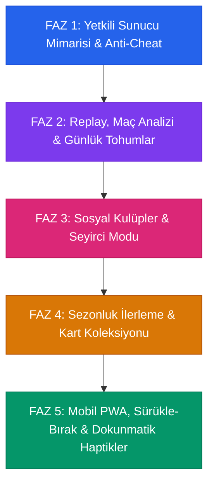

# 🗺️ Project P: İleriye Yönelik Yol Haritası (Product Roadmap)

Bu belge, **Project P (Pişti & RENQ: Overdrive)** projesinin tamamlanan kilometre taşlarını, planlanan ana geliştirme fazlarını ve geleceğe yönelik inovasyon fikirleri havuzunu detaylandırmaktadır.

---

## 📍 Tamamlanan Kilometre Taşları (v1.0 – v1.11)

- [x] **Çekirdek Pişti Motoru (v1.0 - v1.9)**:
  - %100 kurallara uygun deterministik Pişti motoru (2 ve 4 kişilik eşli mod).
  - 5'e Basmalı Özel Kahvehane Varyantı (tek 5'e basıldığında anında galibiyet).
  - 60–240Hz uyumlu Web Animations API (WAAPI) ile gerçekçi 3D kart uçuş fiziği ve havada yüz çevirme.
  - **5 Farklı Profesyonel Deste Karma Animasyonu**: Şelale Köprüsü (Riffle), Hindu Paket Çekme, Kahvehane 3'lü Kesim, Çorba Wash ve Dalga Yelpaze.
  - Pişti kartlarının 90 derece dik açıyla (çapraz) ayrı yığında istiflenmesi.
  - El bitimi masada kartların açılıp *"Tık Tık Tık"* sesleriyle tek tek canlı sayıldığı puan ayırma töreni.
  - Prosedürel Web Audio API ses motoru (sıfır harici ses dosyası bağımlılığı, sentetik fışırtı, tokmak ve patlama sesleri).
  - 7 farklı dinamik masa teması (Kıraathane, Gece Mavisi, Zümrüt Yeşili, Cyberpunk Neon, Galaktik Kozmos, Sonbahar Meşesi, Minimalist Slate) ve Sakura yaprak parçacıkları.
- [x] **RENQ Oyun Modu & Çift Broker Hibrit Multiplayer (v1.10)**:
  - Renk ve sayı eşleme kart oyunu RENQ'in tam teşekküllü entegrasyonu (+2, +4, Pas, Yön Değiştirme, Renk Seçimi ve Ceza çarkı).
  - HiveMQ + EMQX genel MQTT WebSocket broker'ları arasında otomatik yedekleme (failover) ve yerel `BroadcastChannel` hibrit ağı.
  - Kriptografik 6 haneli oda kodları (`PST-xxxxxx` / `RNQ-xxxxxx`), canlı emoji fırlatma ve masa içi sohbet.
- [x] **Güvenlik, Denge ve v1.11 Stabilizasyonu (v1.11)**:
  - **RENQ Online Sıra Senkronizasyonu**: Koltuk rotasyonuyla eşzamanlı sıra çakışması (`currentTurn = 0`) çözüldü; çekilen kart oynanamadığında karşı tarafa `MP_UNO_PASS` anlık iletilerek kilitlenmeler giderildi.
  - **Global RENQ Markalaması**: Tüm arayüz, sohbet şablonları, masa halkası, WhatsApp davetleri ve kural kitapçığı UNO'dan RENQ'e uyarlandı.
  - **Ağ Güvenliği & Paket Doğrulama**: `senderPeerId` ile koltuk eşleştirmesi doğrulandı; sırası olmayan oyuncunun kart oynaması engellendi; monoton dizi numarası (`seq`) ile yinelenen paketler elendi.
  - **Storage & Disk Optimizasyonu**: Periyodik heartbeat paketlerinin `localStorage` ve sekme `storage` event'lerini gereksiz tetiklemesi önlendi.
  - **Puanlama Doğruluğu**: 5'e basmalı ve kurallardan gelen bonus puanlar (`bonusPoints`) detaylı döküm ve toplam skora dahil edildi.
  - **Yetki Güvenliği**: İsim bazlı sahte kurucu rozeti açığı kapatıldı; kriptografik oturum doğrulaması getirildi.
  - **Build & Paketleme**: Versiyon numarası `package.json` üzerinden dinamik okundu, bundle bölündü ve `.gitignore` temizlendi.
- [x] **Özel Avatar & Arkadaşlar Ağı (v1.12)**:
  - Kullanıcı yüklediği özel profil fotoğraflarının arkadaşlar ve çevrimiçi oyuncular listesinde anlık yayınlanması ve senkronizasyonu.
- [x] **Deste Kesme & RENQ Ceza Senkronizasyonu (v1.13)**:
  - **Online RENQ Ceza Senkronizasyonu & Fizik**: +2 ve +4 ceza kartları oynandığında mükerrer paket gönderimi önlendi, sıra kilitlenmesi giderildi; yerdeki ceza kartlarının oyuncuya uçarken fiziksel olarak masadan kalkması sağlandı.
  - **Maç İçi Profil Rozetleri**: Oyuncu ünvanlarının (`customTitle`) maç içi skor tabelası ve oyuncu kartlarında gösterilmesi.
  - **Lobi Temizliği**: Maçtan çıkıldığında eski lobi durumunun tamamen sıfırlanması.
  - **Kural & Ses Ayarları**: 5'e basmalı kuralı varsayılan olarak kapatıldı; varsayılan ses düzeyi %50'ye ayarlandı.
- [x] **Sağdan Kayan Bağımsız Sosyal Menüsü & UI Ergonomisi (v1.14.1)**:
  - **Sağdan Kayan Drawer Sosyal Paneli**: Ekranın sağ üst köşesine bağımsız "Sosyal" erişim butonu eklendi; ana menüden bağımsız olarak açılır ve arka planı kilitlemez (`hideBackdrop`).
  - **Eşzamanlı Kullanım**: Sosyal çekmecesi açıkken ana menüdeki tüm butonlar, oyun modları ve ayarlar tam işlevsel kalır; elle kapatılana kadar açık kalır.
  - **Arayüz Üst Üste Binme Koruması**: Sosyal çekmecesi açıkken ana menü ve üst navigasyon dinamik olarak sola ötelenir (`xl:mr-96`, `2xl:mr-[420px]`); butonlar veya kartlar birbirinin üzerine binmez.

- [x] **Fiziki Masa Kesimi, Sosyal İstekler, Seviye & Görev Sistemi (v1.14)**:
  - **Fiziki Masa Üstü Deste Kesme (In-Table Physical Deck Cut)**: Ayrı pencere yerine doğrudan masa çuhasında yayılan 52 kart; sadece tura başlayacak oyuncunun kesebilmesi; çok oyunculuda `MP_DECK_CUT` ile anlık senkronizasyon; kesilen 2 destenin kalınlıklarıyla masada ayrılması, 4 yer kartının dağıtımı (Vale kesene yarar ödülü) ve destelerin birleşimi.
  - **Sosyal (Social) Çekmecesi & Arkadaşlık İstekleri**: "Arkadaşlar" -> "Sosyal" revizyonu; ana menüde sağ üstte konumlandırma; anında ekleme yerine istek gönderme (`FRIEND_REQUEST`), kabul etme (`FRIEND_ACCEPT`) ve reddetme akışı.
  - **Tüm Oyuncular ve Rakipler İçin Ünvanlar**: Pişti masasında, skor tabelasında, RENQ masasında ve profil incelemesinde tüm oyuncuların ünvan ve rozetlerinin görüntülenmesi.
  - **Seviye (Level) & XP Altyapısı**: Maç tamamlama, galibiyet ve piştilerden XP kazanımı; Seviye ilerleme çubuğu ve seviye atlama kutlaması.
  - **Maç Geçmişi & Günlük Görevler**: Profilde "Maç Geçmişi" sekmesi (son maçların mod, skor, pişti, galibiyet detayları) ve "Günlük Görevler" (her gün 00:00'da sıfırlanan 3 görev, XP ödülleri).
  - **Anlık Hükmen Ayrılma & Hızlı Kopma Algılama**: Disconnect algılama süresinin 25 saniyeden 8 saniyeye indirilmesi, maçtan ayrılan oyuncu için 0ms gecikmeyle anında hükmen galibiyet işlenmesi; lobide eski odada kalma hatasının tamamen giderilmesi.

---

## 🚀 Geliştirme Fazları Planı

---

## 💡 Gelecek Fikirleri & İnovasyon Havuzu (Topluluk Önerileri)

Gelecek sürümlerde değerlendirilmek üzere kaydedilen 12 stratejik iyileştirme ve inovasyon maddesi:

### 1. 🛡️ Yetkili Sunucu Mimarisi (Authoritative Backend & Anti-Cheat)
- **Açıklama:** Mevcut P2P/MQTT yapısında istemciler deste tohumunu (`seedDeck`) paylaşmaktadır. Gelecekte Cloudflare Workers, Go veya Node.js tabanlı hafif bir sunucu ile destenin ve rakiplerin ellerinin yalnızca sunucuda saklandığı ("Fog of War") mimariye geçiş.
- **Kazanım:** Konsoldan veya ağ trafiğinden kartların okunmasını %100 engeller, resmi dereceli (ranked) lig maçlarına zemin hazırlar.

### 2. 🎬 Replay & Öne Çıkanlar (Highlights Engine)
- **Açıklama:** Oynanan her turun hamlelerinin hafif bir JSON veri yapısı olarak kaydedilmesi.
- **Kazanım:** Maç sonunda oyuncuların oyunu baştan sona animasyonlu tekrar izleyebilmesi, "Son Çift Pişti" veya "Büyük Süpürme" gibi anların GIF veya kısa video olarak sosyal medyaya aktarılabilmesi.

### 3. 🧩 Günlük Bulmaca / Daily Seed Challenge
- **Açıklama:** Her gün gece yarısı tüm oyunculara aynı karıştırılmış deste tohumunun (daily seed) sunulması.
- **Kazanım:** "Günün Destesinde En Çok Piştiyi Kim Yapar?" konseptiyle oyuncuların aynı kart dağılımında botlara karşı stratejilerini yarıştırıp günlük global liderlik tablosunda sıralanması.

### 4. 🧠 Bot Kişilikleri ve Maç Sonu Analizörü (AI Match Insights & Coaching)
- **Açıklama:** Botlara farklı oyun tarzları kazandırılması (Örn: *Agresif Aslan*, *Garantici Memur*, *Ters Köşe Kurnaz*) ve maç bitiminde mini yapay zeka koçu analizi.
- **Kazanım:** *"5. turda elindeki Vale yerine 8'liyi atsaydın rakibin Pişti yapmasını engelleyebilirdin (+10 puan farkı)"* gibi öğretici maç sonu analiz raporları.

### 5. 🔄 Reconnect & Bot Devralma (Drop-in AI Handover)
- **Açıklama:** Çevrimiçi maç sırasında interneti kopan, sekmeyi kazara kapatan veya çağrı gelen bir oyuncunun yerine saniyeler içinde geçici yapay zekanın (Bot) oturması.
- **Kazanım:** Oyuncu geri bağlandığında kesintisiz elini devralabilir; kalan oyuncuların maçı düşme/donma sebebiyle yarıda kalmaz.

### 6. 👁️ Seyirci Modu (Spectator Mode & Delay Buffer)
- **Açıklama:** Odalara oyuncu dışında "İzleyici" olarak katılma seçeneği (`spectator: true`).
- **Kazanım:** Turnuva yayıncıları veya arkadaşlar için masayı dışarıdan canlı izleme imkanı; kopya çekmeyi (ghosting) engellemek adına opsiyonel 10-15 saniyelik yayın gecikmesi tamponu.

### 7. 🗣️ Sesli Sohbet & Otantik Replikler (Audio Emotes & WebRTC Voice)
- **Açıklama:** Masada atmosferi yükseltecek Türkçe kahvehane nida ses efektleri (*"Kelle gitti!"*, *"Ne vurdu be!"*, *"Dağılın!"*) ve arkadaşlar arası opsiyonel bas-konuş WebRTC ses kanalı.
- **Kazanım:** Oyun içi samimiyeti ve rekabet coşkusunu üst seviyeye taşır.

### 8. 🎨 Sezonluk Başarım ve Kart Koleksiyonu (Pass & Skin Laboratory)
- **Açıklama:** Görevler tamamlandıkça veya galibiyet aldıkça açılan kozmetik vitrini.
- **Kazanım:** Özel kart arka desenleri (Nazar Boncuğu, Göktürk Motifleri, Altın Varak, Cyber Neon), masa halıları, özel efektli kart vurma animasyonları ve profil unvanları.

### 9. 📱 Mobil PWA & Dokunmatik Sürükle-Bırak (Haptic Touch & Fling)
- **Açıklama:** Service Worker ve Web App Manifest ile ana ekrana tam ekran uygulama olarak yüklenebilme, mobilde kartları parmakla masanın ortasına fırlatma (fling) fiziği.
- **Kazanım:** Web Vibration API ile kart masaya indiğinde hafif vuruş hissi, Pişti anında ise güçlü çift titreşimle native mobil oyun hissi.

### 10. ⚡ Yeni Oyun Modları & Varyasyonlar (Blitz Pişti & Kaos RENQ)
- **Açıklama:**
  - *Blitz Pişti:* Tur başına sadece 5 saniye düşünme süresi olan aşırı hızlı tempolu mod.
  - *Kaos RENQ:* Her 3 turda bir masa renginin veya oyun yönünün rastgele değiştiği sürpriz kural kartları.
- **Kazanım:** Oyuncular için alternatif parti eğlenceleri.

### 11. 👥 Kulüp / Klan Sistemi (Sosyal Masalar)
- **Açıklama:** Oyuncuların kendi arkadaş gruplarıyla özel kulüp odaları oluşturması, kulüp içi haftalık skor tahtaları ve turnuva fikstürleri.
- **Kazanım:** Kalıcı bir oyuncu topluluğu ve organik bağlılık.

### 12. ♿ Gelişmiş Erişilebilirlik & Sesli Betimleme (Screen Reader & High Contrast)
- **Açıklama:** Görme engelli veya az gören oyuncular için ekran okuyucu uyumluluğunun tam sesli oyun betimlemesine dönüştürülmesi (*"Masa: Karo 7, Elinizde: Sinek 7, Kupa Vale..."*).
- **Kazanım:** Renk körü filtreleri, yüksek kontrast modu ve klavye/kumanda kısayollarıyla herkes için %100 erişilebilir kart oyunu standardı.
