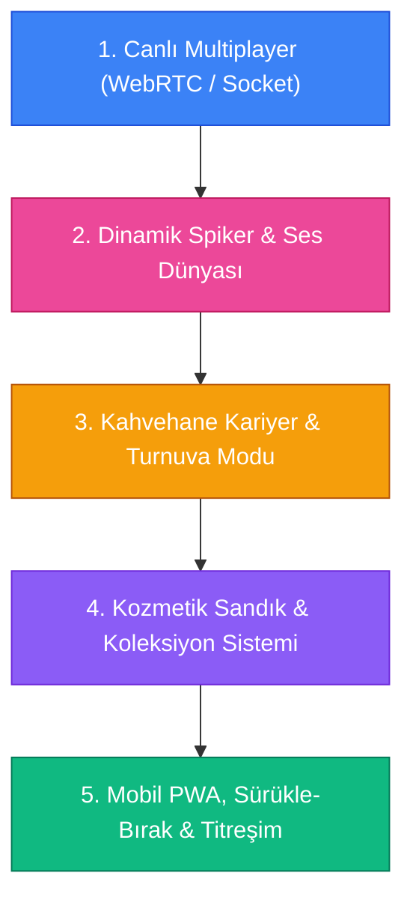

# 🗺️ Project Pişti: İleriye Yönelik Yol Haritası (Next-Gen Roadmap)

Bu belge, oyunun mevcut sağlam tek oyunculu ve animasyon temelleri üzerine inşa edilecek **gelecek geliştirme fazlarını** ve eklenebilecek en heyecan verici özellikleri detaylandırmaktadır.

---

## 📍 Mevcut Durum (Tamamlananlar)
- [x] %100 Kurallara Uygun Deterministik Pişti Motoru (2 ve 4 Kişilik Eşli Takım Modu).
- [x] 5'e Basmalı Özel Kahvehane Varyantı (Anında Galibiyet Mekaniği).
- [x] 60 FPS Web Animations API ile Gerçekçi 3D Kart Uçuş Fiziği ve 3D Havada Yüz Çevirme.
- [x] **5 Farklı Kaliteli Deste Karma Animasyonu (Rastgele 1/5 Seçim: Şelale, Hindu, 3'lü Kesim, Çorba Wash, Dalga)**.
- [x] **Pişti Kartlarının 90 Derece Açıyla (Tersli Düzlü) Ayrı Yığında İstiflenmesi**.
- [x] **El Bitimi Masada Kartları Döndürüp "Tık Tık Tık" Canlı Sayım & Puan Ayırma Töreni**.
- [x] **Faz 1 Canlı Multiplayer (P2P WebRTC / BroadcastChannel, 15s Sayaç, Çay/İfade Fırlatma)**.
- [x] **🌸 Sakura Cherry Blossom Spirit** Teması, Dökülen Çentikli Kiraz Çiçeği Yaprakları & Ruh Küreleri.
- [x] 5 Farklı Masa Teması & 4 Farklı Özel Kart Arkası Koleksiyonu.
- [x] 3 Farklı Yapay Zeka Kişiliği (Acemi, Kurnaz, Kart Sayan Şampiyon).
- [x] Görüşü Engellemeyen Optimize Edilmiş Arcade Pişti Bildirim Banner'ı.

---

## 🚀 İleriye Yönelik Faz Planı

---

### 🌐 FAZ 1: Canlı Çok Oyunculu (Multiplayer) & Eşzamanlı Ağ
> **Hedef:** Arkadaşlarınla 6 haneli oda koduyla sıfır gecikmeli Pişti düelloları ve 2v2 Eşli maçlar yapmak.

- [ ] **Sunucusuz P2P WebRTC (PeerJS) veya Hafif WebSocket Sunucusu**:
  - Oyuncu "Oda Aç" dediğinde 6 haneli kod üretilir (`PST-8492`).
  - İkinci (veya 4 kişilikte 3. ve 4.) oyuncu bağlantı linkiyle veya kodu girerek odaya katılır.
- [ ] **Sıra Zamanlayıcısı (Turn Timer)**:
  - Hamle başına 15 saniye geri sayım barı (süre bitince rastgele kart oynama cezası).
- [ ] **Canlı Sosyal İfadeler & Hızlı Çatışma (Emotes)**:
  - Masaya fırlatılabilen interaktif emojiler: Çay bardağı tıkırdatma ☕, alev 🔥, kahkaha 🤣, gözyaşı 😭, kafaya vurma 🤦‍♂️.
- [ ] **Bağlantı Kopma Koruması (Reconnect Handling)**:
  - İnterneti kopan oyuncunun yerine botun geçici olarak devam etmesi ve oyuncu dönünce devralması.

---

### 🎙️ FAZ 2: Dinamik Spiker Nidası & Tema Müzikleri
> **Hedef:** Oyundaki arcade hissiyatını ve mizahı tavan yaptıracak ses atmosferi.

- [ ] **Arcade Spiker / Kahvehane Nida Sesleri**:
  - Pişti anında: *"PİŞTİİİ!", "NE VURDU BE!", "OTURDU!", "VALE GELDİ SÜPÜRDÜ!"*.
  - 5'e basıldığında: *"5'E BASTI! DAĞILIN!", "KELLE GİTTİ!"*.
  - Web Audio osilatörleri veya yüksek kaliteli hafif sıkıştırılmış nida klipleri.
- [ ] **Temaya Göre Ortam Fon Müziği (Ambient Soundscape)**:
  - *Sakura Spirit*: Arka planda derinden gelen huzurlu Koto ve Shakuhachi ezgileri.
  - *Zümrüt Kıraathane*: Arkada hafif çay kaşığı şıngırtısı ve kahve sohbet uğultusu.
  - *Siber Neon*: Retro synthwave bas yürüyüşleri.

---

### 🏆 FAZ 3: Kahvehane Kariyer & Turnuva Modu
> **Hedef:** Tek oyunculu deneyimi sadece tek maçtan çıkarıp uzun soluklu bir maceraya dönüştürmek.

- [ ] **Türkiye & Dünya Pişti Turnuvası**:
  - *Masa 1:* Mahalle Çay Ocağı (Rakip: Acemi Çırak)
  - *Masa 2:* Kadıköy Kıraathanesi (Rakip: Kurnaz Emekli Memur)
  - *Masa 3:* Boğaz Kulübü (Rakip: Kart Sayan Analist)
  - *Masa 4:* Kyoto Sakura Tapınağı Özel Turnuvası (Usta Pişti Üstadı)
- [ ] **Farklı Bot Karakterleri & Replikleri**:
  - Botların hamle yaparken ekranda küçük konuşma baloncukları çıkarması (*"O kartı atmayacaktın evlat..."*, *"Elimde bir şey kalmadı ya"*).

---

### 🎁 FAZ 4: Kozmetik Kilit Açma & Koleksiyon Sandığı
> **Hedef:** Maç kazandıkça ve Pişti yaptıkça açılan ödül döngüsü.

- [ ] **Çip & Puan Sistemi**:
  - Yapılan her normal Pişti için +100 Çip, Çift Pişti için +250 Çip, maç galibiyetine +500 Çip.
- [ ] **Kilit Açılabilir Kozmetikler**:
  - *Yeni Kart Arkaları:* Türk Bayrağı / Nazar Boncuğu deseni, Samuray Kılıcı, Cyber Glitch.
  - *Masa Halıları:* Osmanlı Lale Deseni Çuha, Gece Yarısı Mat Siyah Deri.
  - *Kart Atma Efektleri:* Masaya kart vurunca çıkan alev patlaması, yıldırım çakması veya sakura fırtınası.

---

### 📱 FAZ 5: Mobil PWA, Sürükle-Bırak & Dokunmatik Hissiyat
> **Hedef:** Mobilde tıpkı App Store / Google Play'den indirilmiş bir native oyun gibi kusursuz deneyim.

- [ ] **Kart Sürükle-Bırak (Touch Drag & Drop)**:
  - Parmağınla elindeki kartı tutup masanın ortasına fiziksel olarak fırlatma.
- [ ] **Haptik Titreşim (Vibration API)**:
  - Kart masaya oturduğunda hafif titreşim, Pişti patladığında güçlü çift titreşim.
- [ ] **PWA Kurulum Desteği**:
  - Tarayıcıda "Uygulamayı Ana Ekrana Ekle" butonuyla tam ekran, çubuksuz mobil uygulama açılışı.
